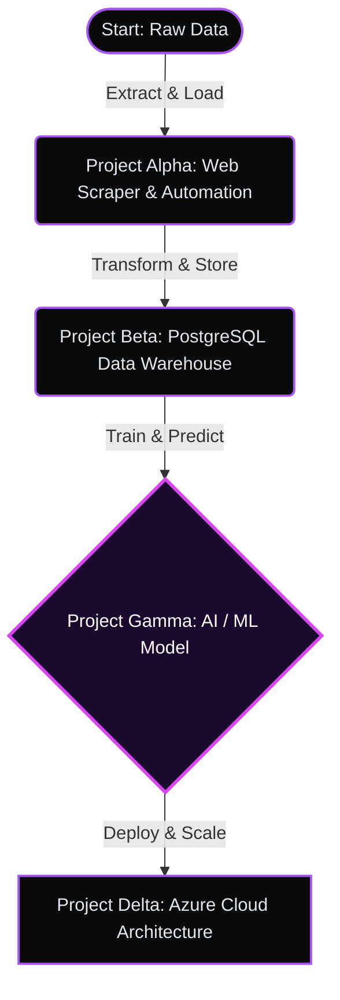

👥👥👥👥👥👥👥👥👥👥👥👥👥👥👥👥👥👥👥👥🦛🦛🦛🦛🦛🐈‍⬛🐈‍⬛🐈‍⬛🐈‍⬛🦛🦛🦛👥👥👥👥👥👥👥👥👥👥👥👥👥👥👥👥👥👥👥👥👥👥 
👥👥👥👥👥👥👥👥👥👥👥👥👥👥👥👥🦛🦛🦛🦛🦛🐈‍⬛🐈‍⬛🐈‍⬛🐈‍⬛🐈‍⬛🦯🦯🦯🐈‍⬛🐈‍⬛🐈‍⬛🦛👥👥👥👥👥👥👥👥👥👥👥👥👥👥👥👥👥👥👥👥👥 
👥👥👥👥👥👥👥👥👥👥👥👥👥👥🦛🦛🦛🐈‍⬛🐈‍⬛🐈‍⬛🐈‍⬛🦯🦯🦯🦯🦯🦯🦯🦯🦯🦯🦯🐈‍⬛🦛👥🦛🦛👥👥👥👥👥👥👥👥👥👥👥👥👥👥👥👥👥 
👥👥👥👥👥👥👥👥👥👥👥👥👥🦛🐈‍⬛🐈‍⬛🐈‍⬛🐈‍⬛🐈‍⬛🦯🦯🦯🦯🦯🦯🦯🦯🦯🦯🦯🦯🦯🦯🐈‍⬛🦛🐈‍⬛🦯🦛🦛👥👥👥👥👥👥👥👥👥👥👥👥👥👥👥 
👥👥👥👥👥👥👥👥👥👥👥🦛🦛🦛💱💱💱🦯🦯🦯🦯🦯🦯🦯🦯🦯🦯🦯🦯🦯🦯🦯🦯🦯🦯🦯🦯🦯🦯🦯🦯👥👥👥👥👥👥👥👥👥👥👥👥👥 
👥👥👥👥👥👥👥👥👥👥👥👥👥🦛💱🦯🦯🦯🦯🦯🦯🦯🦯🦯🦯🦯🦯🦯🦯🦯🦯🦯🦯🦯🦯🦯🦯🦯🦯🦯🦯🦛👥👥👥👥👥👥👥👥👥👥👥👥 
👥👥👥👥👥👥👥👥👥👥👥👥🦛💱🦯🦯🦯🦯🦯🦯🦯🦯🦯🦯🦯🦯🦯🦯🦯🦯🦯🦯🦯🦯🦯🦯🦯🦯🦯🦯🦯🦯🦛👥👥👥👥👥👥👥👥👥👥👥 
👥👥👥👥👥👥👥👥👥👥👥🦛🦛💱🦯🦯🦯🦯🦯🦯🦯🦯🦯🦯🦯🦯🦯🦯🦯🦯🦯🦯🦯🦯🦯🦯🦯🦯🦯🦯🦯🦯🦛👥👥👥👥👥👥👥👥👥👥👥 
👥👥👥👥👥👥👥👥👥👥🦛💱🦛💱🦯🦯🦯🦯🦯🦯🦯🦯🦯🦯🦯🦯🦯🦯🦯🦯🦯🦯🦯🦯🦯🦯🦯🦯🦯🦯🦯🦯🦛🦛👥👥👥👥👥👥👥👥👥👥 
👥👥👥👥👥👥👥👥🦛🕴🏿💱🦯🦯🦯🦯🦯🦯🦯🦯🦯🦯🦯🦯🦯🦯🦯🦯🦯🦯🦯🦯🦯🦯🦯🦯🦯🦯🦯🦯🦯🦯🦯🦯🦯🦛👥👥👥👥👥👥👥👥👥 
👥👥👥👥👥👥👥👥🦛🕴🏿🕴🏿🦯🦯🦯🦯🦯🦯🦯🦯🦯🦯🦯🦯🦯🦯🦯🦯🦯🦯🦯🦯🦯🦯🦯🦯🦯🦯🦯🦯🦯🦯🦯🦯🦯🦛👥👥👥👥👥👥👥👥👥 
👥👥👥👥👥👥👥👥🦛🦛🦯🦯🦯🦯🦯🦯🦯🦯🦯🦯🦯🦯🦯🦯🦯🦯🦯🦯🦯🦯🦯🦯🦯🦯🦯🦯🦯🦯🦯🦯🦯🦯🦯🦯🦛👥👥👥👥👥👥👥👥👥 
👥👥👥👥👥👥👥👥👥🦛🦯🦯🦯🦯🦯🦯🦯🦯🦯🦯🦯🦯🦯🦯🦯🦯🦯🦯🦯🦯🦯🦯🦯🦯🦯🦯🦯🦯🦯🦯🦯🦯🦯🦯🦛🦛👥👥👥👥👥👥👥👥 
👥👥👥👥👥👥👥👥🦛🦛🦯🦯🦯🦯🦯🦯🦯🦯🦯🦯🦯🦯🦯🦯🦯🦯🦯🦯🦯🦯🦯🦯🦯🦯🦯🦯🦯🦯🦯🦯🦯🦯🦯🦯🦯🦛👥👥👥👥👥👥👥👥 
👥👥👥👥👥👥👥👥🦛🦯🦯🦯🦯🦯🦯🦯🦯🦯🦯🦯🦯🦯🦯🦯🦯🦯🦯🦯🦯🦯🦯🦯🦯🦯🦯🦯🦯🦯🦯🦯🦯🦯🦯🦯🦯🦛👥👥👥👥👥👥👥👥 
👥👥👥👥👥👥🦛🦯🦯🦯🦯🦯🦯🦯🦯🦯🦯🦯🦯🦯🦯🦯🦯🦯🦯👨🏼‍🚒👨🏼‍🚒🦯🦯🦯🦯🦯👨🏼‍🚒🌇🌇🦯👨🏼‍🚒👨🏼‍🚒👨🏼‍🚒👨🏼‍🚒🚂🦯🦯🦯🦯🦯🦛👥👥👥👥👥👥👥 
👥👥👥👥👥👥👥👥🦯🦯🦯🦯🦯🦯🦯🦯🦯🦯🦯🦯👨🏼‍🚒👨🏼‍🚒👨🏼‍🚒👨🏼‍🚒👨🏼‍🚒👨🏼‍🚒👨🏼‍🚒👨🏼‍🚒👨🏼‍🚒👨🏼‍🚒👨🏼‍🚒👨🏼‍🚒🌇🌇🌇🌇🌇🌇🌇🌇🌇🦯🦯🦯🦯🦯🦛👥👥👥👥👥👥👥 
👥👥👥👥👥👥👥🦛🦯🦯🦯🦯🦯🦯🦯🦯🦯🦯🦯👨🏼‍🚒🌇🌇🌇🌇🌇🌇🌇🌇🌇🌇🌇🌇🌇🦯🦯🦯🦯🦯🦯🦯🌇🦯🦯🦯🦯🦯🦛🦛👥👥👥👥👥👥 
👥👥👥👥👥👥👥🦛🦯🦯🦯🦯🦯🦯🦯🦯🦯🦯🦯🦯🦯🦯🦯🦯🦯🌇🌇🌇🌇🌇🌇🌇🌁🌁🌁🌁🦯🌁🌁🌁🚶🏼‍♂️‍➡️👨🏼‍🚒🦯🦯🦯🦯🦛👥👥👥👥👥👥👥 
👥👥👥👥👥👥👥🦛🦯🦯🦯🦯🦯🦯🦯🦯🦯👨🏼‍🚒🦯🌁🌁🌁🦯🌁🌁🌇🌇🌇🌇🌇🌇👨🏼‍🚒🌁🌁🌁🌁🌁🌁🌁🌁🌁🌇👨🏼‍🚒🦯🦯🦯🦛👥👥👥👥👥👥👥 
👥👥👥👥👥👥🚰👩🏿‍💼🦯🦯🦯🦯🦯🦯🦯👨🏼‍🚒👩🏼‍❤️‍💋‍👨🏼👩🏾‍🦳🌁🌁🌁🌁🌁🌁🌁🌁🌇🌇🌇🌇🌇👩🏼‍❤️‍💋‍👨🏼🏻🦯🌁🌁🌁🌁🌁🌁🧾🌇🌇👨🏼‍🚒👃🏾🦛👥👥👥👥👥👥👥👥 
👥👥👥👥👥👥👥👥🦯🦯🦯🦯🦯🦯🦯👨🏼‍🚒🌇🦯🌁🌁🌁🌁🌁🌁🌁🌁🌇🌇🌇🌇🌇🌇👨🏼‍🚒🌇🦯🗓️🗓️🗓️🗓️🦯🌇🌇🌇🌇🥓👥👥👥👥👥👥👥👥👥 
👥👥👥👥👥👥👥👥🦯🦯🦯🦯🦯🦯👨🏼‍🚒🌇🌇🌇🦯🌁🌁🌁🌁🌁🌁🦯🌇🌇🌇🌇🌇🌇🌇👨🏼‍🚒🌇🦯🦯🦯🦯🌇🌇🌇🌇🌇🥓🥓👥👥👥👥👥👥👥👥 
👥👥👥👥👥👥👥👥🦯🦯🦯🦯🦯🦵🏿🌇🌇🌇🌇🌇🦯🗓️🗓️🗓️🗓️🦯🌇🌇🌇🌇🌇🌇🌇🌇👨🏼‍🚒🌇🌇🌇🌇🌇🌇🌇🌇🌇🌇🥓🌇👥👥👥👥👥👥👥👥 
👥👥👥👥👥👥👥👥🦯🦯🦯🦯🦯🦵🏿🌇🌇🌇🌇🌇🌇🦯🦯🦯🦯🌇🌇🌇🌇🌇🌇🌇🌇🌇👨🏼‍🚒🌇🌇🌇🌇🌇🌇🌇🌇🌇🌇🥓🌇👥👥👥👥👥👥👥👥 
👥👥👥👥👥👥👥👥👥👥👥🦯👨🏼‍🚒👨🏼‍🚒🌇🌇🌇🌇🌇🌇🌇🌇🌇🌇🌇🌇🌇🌇🌇🌇🌇🌇👨🏼‍🚒🌇🌇🅰️🅰️🅰️🅰️🅰️🌇🌇🌇🌇🥓🌇👥👥👥👥👥👥👥 
👥👥👥👥👥👥👥👥👥👥💥🌇🌇🙅‍♀️🌇🌇🌇🌇🅰️🅰️🅰️🅰️🅰️🅰️🌇🌇🌇🌇🌇🌇🌇🌇🌇🌇🌇🅰️🅰️🅰️🅰️🅰️🌇🌇🌇🌇🥓👥👥👥👥👥👥👥 
👥👥👥👥👥👥👥👥👥🥓🌇🌇🌇🙅‍♀️🌇🌇🌇🌇🌇🅰️🅰️🅰️🅰️🌇🌇🌇🌇🌇🌇🌇🌇🌇🌇🌇🌇🌇🌇🌇🌇🌇🌇🌇🌇🌇🥓👥👥👥👥👥👥👥👥 

<h1 align="center">Hi there, I'm Jonatas! 👋</h1>

  <b>Data Scientist & Data Engineer | Open Source Contributor</b> 
  <i>Transforming raw data into intelligent, automated solutions.</i>

---

### 👾 About Me

I am a data-driven professional with a strong focus on **Data Engineering, Artificial Intelligence, and Automation**. Unlike traditional developers, my passion lies in the architecture of data and the insights we can extract from it. I actively contribute to **Open Source** projects and am constantly building pipelines that bridge the gap between complex datasets and actionable AI.

- 🔭 I’m currently working on: **[Insert your current main project, e.g., an automated ETL pipeline]**
- 🌱 I’m currently learning: **[Insert tech, e.g., Advanced MLOps or Azure Data Factory]**
- 🤝 I’m looking to collaborate on: **Open Source Data/AI initiatives**
- ⚡ Fun fact: **[Insert a fun fact about you]**

---

### 🗺️ The Data Journey (My Projects)

My work is best understood as a continuous pipeline. Below is the trail of my main architectures and projects, from data extraction to AI deployment.

 

#### 📂 Featured Repositories

| Project | Description | Core Tech | Status |
| :--- | :--- | :---: | :---: |
| **[Project Alpha](https://github.com/seu-usuario/repo-alpha)** | Automated data extraction pipeline that scrapes 10k+ records daily and automates basic data cleaning. | `Python` `BeautifulSoup` | 🟢 Active |
| **[Project Beta](https://github.com/seu-usuario/repo-beta)** | Centralized relational database structure utilizing advanced SQL queries and views for BI dashboards. | `PostgreSQL` | 🟡 V2 WIP |
| **[Project Gamma](https://github.com/seu-usuario/repo-gamma)** | Predictive Machine Learning model for forecasting [insert domain] trends with 92% accuracy. | `Python` `Scikit-Learn` | 🟢 Completed |
| **[Project Delta](https://github.com/seu-usuario/repo-delta)** | Cloud-native deployment of the ML models using serverless functions and automated triggers. | `Azure` `Docker` | 🔵 Scaling |

*(Click on the project names to view the source code and documentation)*

---

### ⚙️ Core Technologies

While projects define my journey, these are the tools I use to pave the way:

  
  <!-- Python & Data Stack -->
  
  
  
  
  <!-- Databases -->
  
  
  <!-- Cloud & DevOps -->
  
  
  

---

### 📊 GitHub Analytics

  
  

  

---

### 📡 Establish Connection

  
  

