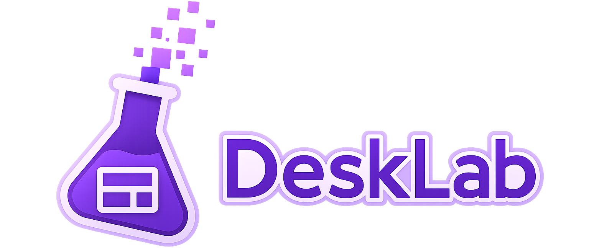
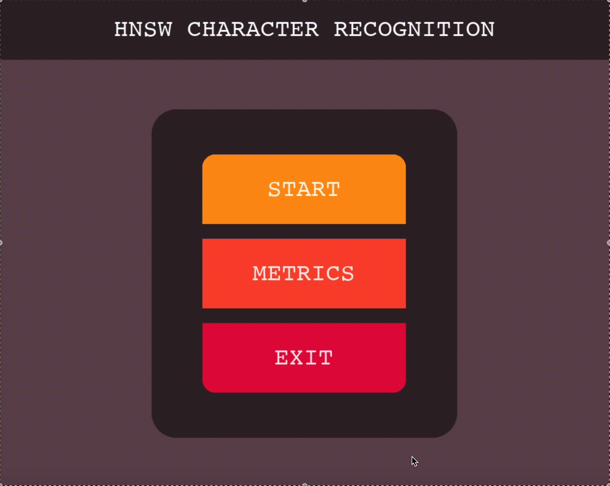

# 🥀 JonatasCortes 🥀

### ♦️Data Scientist / Data Enginieer♦️

```python
print(
  """
  >>====================================================<<
    Passionate about experimenting new things and   
    contributing to the open source `python` community.

    Mostly interested in Machine Learning, LLMs and
    automations for various applications.
  >>====================================================<<
  """
)
```

---

## 🩸Projects and Contributions🩸

### 📌 Desklab



It is an open-source GUI library for Python applications that gives developers direct control over the event loop.

By avoiding the additional abstraction layers common in traditional GUI frameworks, it enables finer control over user input, event handling, and concurrent processing.

Check out the [GitHub repository](https://github.com/ThePyManiacs/DeskLab) and consider contributing!

---

### 📌 HNSW Character Recognition



Train and test your own **HNSW (Hierarchical Navigable Small World)** model in pure python (no ML library used) using the **Balanced EMNIST dataset**.

Explore detailed performance metrics, including correct and incorrect classifications, accuracy, total testing time, and a complete **47-class confusion matrix**.

Check out the [GitHub repository](https://github.com/JonatasCortes/hnsw-character-recognition) to run the project yourself and evaluate the results.

---


## ☎️ Core Technologies

While projects define my journey, these are the tools I use to pave the way:

<div align="center">

  <!-- Python & Data Stack -->
  
  
  

  <!-- Databases -->
  

  <!-- Cloud & DevOps -->
  
  
  

</div>

---

### 🆘 GitHub Analytics

<div align="center">
  
  
</div>

<div align="center">
  
</div>

---

### ‼️ Establish Connection

<div align="center">
  <a href="https://www.linkedin.com/in/jônatas-gonçalves-pereira-ramos-côrtes" target="_blank">
    
  </a>
  <a href="mailto:joncortes.on@gmail.com@gmail.com">
    
  </a>
</div>
